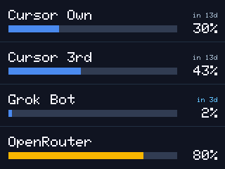
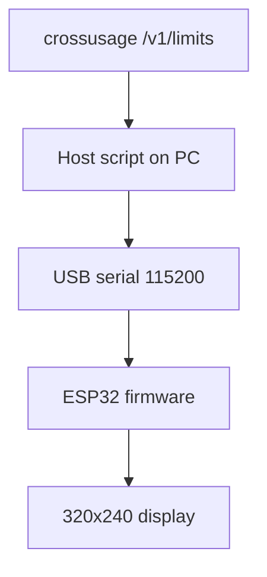

# cyd-usage-dashboard

ESP32 firmware for the Cheap Yellow Display (CYD) that draws AI usage and quota
bars. A host sends row data over USB serial at 115200 baud; the device has no
Wi‑Fi and does not fetch or persist limits itself.



## How it works

Any program on your PC can open the board’s serial port, send text commands, and
call `usage show` to refresh the screen. A typical setup runs
[crossusage](https://github.com/barramee27/crossusage) locally, polls its
`/v1/limits` JSON API, maps fields to `usage set` lines, then redraws. The
firmware is agnostic to that pipeline—it only parses commands and paints bars.



## Hardware

- **Board:** ESP32-2432S028R (CYD), landscape (rotation 1)
- **Panel:** ILI9341 (`ILI9341_2_DRIVER`), HSPI, 240×320 physical, 320×240 after
  rotation
- **Not used:** touch, SD card

| Signal   | GPIO                |
| -------- | ------------------- |
| TFT_MISO | 12                  |
| TFT_MOSI | 13                  |
| TFT_SCLK | 14                  |
| TFT_CS   | 15                  |
| TFT_DC   | 2                   |
| TFT_RST  | (not connected, -1) |
| TFT_BL   | 21 (active high)    |

SPI frequency is 27 MHz (see [platformio.ini](platformio.ini)).

## Build and flash

Requires [PlatformIO](https://platformio.org/).

```bash
pio run -t upload
pio run -t monitor
```

Monitor speed is 115200. Libraries (`bodmer/TFT_eSPI`, `txgruppi/parseargs`) are
pulled from `lib_deps`. TFT pins and driver flags are set in
`platformio.ini`—you do not need to edit TFT_eSPI’s `User_Setup.h`.

## Serial protocol

### Transport

- **115200** 8N1 on the USB-UART bridge (e.g. `/dev/ttyUSB0`).
- One command per line, terminated with `\n` (a leading `\r` is ignored).
- Characters are echoed; backspace and common ANSI escape sequences are stripped
  from input.
- Arguments are parsed [shell-style](https://github.com/txgruppi/parseargs-c)
  (quoted strings for names with spaces).

### Commands

| Command                                 | Description                                                     |
| --------------------------------------- | --------------------------------------------------------------- |
| `usage set <index> <days> <pct> <name>` | Set row at `index`: days until reset, utilization %, label      |
| `usage resize <n>`                      | Resize row vector to `n` entries (values unchanged until `set`) |
| `usage reset`                           | Clear all rows                                                  |
| `usage show`                            | Redraw the screen from current rows                             |
| `palette load <12×#RRGGBB>`             | Replace all 12 palette slots and redraw                         |
| `palette dump`                          | Print current palette as `#RRGGBB` (one line)                   |
| `screenshot`                            | Encode the framebuffer as QOI, one hex line on serial           |
| `mem`                                   | Print free heap / max alloc / PSRAM flag                        |

### Behaviour notes

- `usage set`, `usage resize`, and `usage reset` do **not** redraw; send
  `usage show` when you want an update.
- `usage set` grows the row list if `index` is past the end.
- `days = -1` means no reset date (no “in Nd” label).
- Percent text can exceed 100 (e.g. `112%`); the bar fill is clamped to the
  track width.
- At most **12** rows are drawn (`usage::N_MAX`); extra entries in memory are
  ignored for layout.
- `palette load` applies colours and redraws immediately.
- Failures respond with `error: ...` lines.

### Example session

Four rows (shape similar to crossusage → Cursor / Grok / OpenRouter limits):

```
usage resize 4
usage set 0 15 30.00 'Cursor Own'
usage set 1 15 75.00 'Cursor 3rd'
usage set 2 6 0.00 'Grok Bot'
usage set 3 -1 99.00 'OpenRouter'
usage show
```

### Capturing `screenshot` output

The device echoes `screenshot`, then prints a single line of lowercase hex (QOI
file bytes). On Linux, with the serial port in raw mode and only the hex line
captured to a file:

```bash
# After sending the screenshot command, save the hex line to screenshot.hex
xxd -r -p screenshot.hex > screenshot.qoi
```

## Display behaviour

Layout scales with row count:

| Rows | Layout                                              |
| ---- | --------------------------------------------------- |
| 1    | Large single “hero” card                            |
| 2    | Two stacked hero-style cards                        |
| 3    | Medium typography, name + date on one line          |
| 4–6  | Medium: GLCD size 2 name/%, size 1 reset, 10 px bar |
| 7–12 | Compact: size 1 text, thinner bar (6 px or 4 px)    |

**Bar fill colour** (by utilization %):

- &lt; 75% — blue (`C_BLUE`)
- ≥ 75% — amber (`C_WARN`)
- ≥ 90% — red (`C_DANGER`)

**Reset label** (`today` or `in Nd`):

- ≤ 2 days — green (`C_RESET_SOON`)
- ≤ 7 days — cyan (`C_RESET_WEEK`)
- &gt; 7 days — muted (`C_RESET_FAR`)

Long names truncate with `..` when they do not fit.

## Palette

The UI uses a 4-bit sprite with **12** palette indexes. Defaults (RGB565 in
firmware; approximate sRGB shown):

| Idx | Name         | Default   | Role                             |
| --- | ------------ | --------- | -------------------------------- |
| 0   | C_BG         | `#101421` | Background                       |
| 1   | C_TRACK      | `#313C52` | Bar track                        |
| 2   | C_DIV        | `#213042` | Row divider                      |
| 3   | C_BLUE       | `#4A8AEF` | Bar fill &lt; 75%                |
| 4   | C_MUTED      | `#A5BACE` | Muted text                       |
| 5   | C_TEXT       | `#F7F7FF` | Names and %                      |
| 6   | C_GOOD       | `#39CF7B` | Good accent (unused in stock UI) |
| 7   | C_WARN       | `#F7B600` | Bar fill ≥ 75%                   |
| 8   | C_DANGER     | `#E74142` | Bar fill ≥ 90%                   |
| 9   | C_RESET_SOON | `#52E394` | Reset ≤ 2 days                   |
| 10  | C_RESET_WEEK | `#63C3FF` | Reset ≤ 7 days                   |
| 11  | C_RESET_FAR  | `#A5BACE` | Reset &gt; 7 days                |

Example (defaults in one line):

```
palette load #101421 #313C52 #213042 #4A8AEF #A5BACE #F7F7FF #39CF7B #F7B600 #E74142 #52E394 #63C3FF #A5BACE
```

Colours are stored as RGB565; `palette dump` expands to 8-bit channels (slight
rounding vs. your `#RRGGBB` input).

## Project layout

| File                                       | Role                              |
| ------------------------------------------ | --------------------------------- |
| [src/main.cpp](src/main.cpp)               | Serial command dispatch, TFT init |
| [src/console.cpp](src/console.cpp)         | Line editing / echo on serial     |
| [src/UsageScreen.cpp](src/UsageScreen.cpp) | Layout, drawing, palette          |
| [src/screenshot.cpp](src/screenshot.cpp)   | QOI export over serial            |
| [src/Qoi.cpp](src/Qoi.cpp)                 | Minimal QOI encoder               |

## License

MIT — see [LICENSE](LICENSE).
